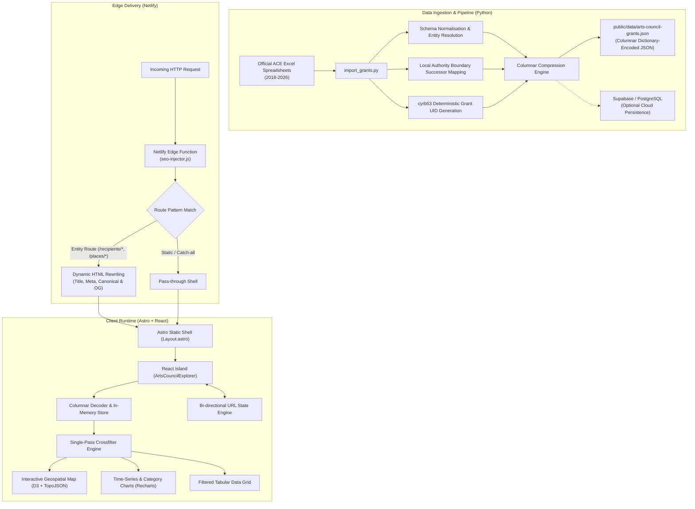

# Arts Council England Funding Grants Explorer (2018-2026)

An open-source data platform, analytics engine and interactive explorer tracking over £800m across 27,000+ Arts Council England National Lottery Project Grants from 2018 to 2026.

The application is engineered as a high-performance Astro 5 web application with React 18 client-side islands, columnar data compression, single-pass crossfilter aggregations, geospatial cartography and edge-rendered metadata injection across 15,000+ programmatic routes.

---

## Technical Architecture Overview

The system is architected to decouple analytical data processing from runtime delivery, ensuring instant client-side interaction without server latency or database query overhead.



### Key Architectural Pillars

- **Hybrid Static and Edge Architecture**: Astro 5 renders an ultra-lightweight HTML shell with pre-connected typography assets, while Netlify Edge Functions intercept requests to dynamically stream SEO tags for over 15,000 programmatic entity URLs.
- **Client-Side Analytical Engine**: The entire 27,000-record dataset loads into browser memory through an optimised columnar format, enabling sub-millisecond filtering, multi-dimensional search and cross-tab calculations without network round-trips.
- **Bi-directional URL State Synchronisation**: Full deep-linking support using semantic paths for entities (`/recipients/:slug`, `/places/:slug`, `/disciplines/:slug` and `/grants/:uid`) combined with query parameters for active filter matrices.
- **Deterministic Entity Resolution**: Python-driven pre-processing reconciles disparate spreadsheet layouts, recipient corporate entity suffixes and local government reorganisations between 2018 and 2026.

---

## Data Pipeline and Ingestion Engine

Arts Council England publishes National Lottery Project Grant awards quarterly in multi-tab Excel workbooks. The reporting format, column naming conventions, date notations and geographical classifications have changed substantially across funding years.

The ingestion engine in `import_grants.py` standardises these disparate records into a unified data contract.

### 1. Schema Reconciliation and Date Normalisation

The ingestion script inspects each workbook, locates the `Project Grants Awards` worksheet and adapts to inconsistent header rows and naming variants:

```python
column_mapping = {
    'recipient': 'recipient',
    'activity name': 'activity_name',
    'activityname': 'activity_name',
    'award amount': 'award_amount',
    'awardamount': 'award_amount',
    'award date': 'award_date',
    'awarddate': 'award_date',
    'decision month': 'decision_month',
    'decision quarter': 'decision_quarter',
    'ace area': 'ace_area',
    'local authority': 'local_authority',
    'main discipline': 'main_discipline',
    'strand': 'strand',
    'time limited priority': 'time_limited_priority'
}
```

Award amounts are parsed into floating-point numeric values, stripping currency symbols, commas and accounting formatting. Award dates are parsed into ISO-8601 calendar dates (`YYYY-MM-DD`). Fiscal quarters and decision months are normalised to align with UK financial years (April to March).

### 2. Recipient Entity Resolution

Grant recipients in raw government data contain variations due to punctuation, capitalisation, legal entity suffixes and typographical differences.

The pipeline implements a two-stage normalisation algorithm:

1. **Canonical Grouping Key (`recipientKey`)**: Strips accents, punctuation, quotes and spacing, expands ampersands to `and`, normalises `limited` to `ltd` and folds characters to lowercase.
2. **Review Key (`looseRecipientKey`)**: Removes leading articles (`The`) and terminal corporate designations (`ltd`, `cic`, `cio`, `llp`, `plc`, `inc` and `and co`) to detect potential duplicate entities across funding cycles for manual audit.

In addition, an organisation inference heuristic inspects recipient titles for corporate keywords, educational institutions, trusts, ensembles and local councils to differentiate legal organisations from individual creative practitioners.

### 3. Local Authority Boundary Reconciliation (2018-2026)

English local government underwent multiple rounds of structural reform between 2018 and 2026. District councils across Dorset, Buckinghamshire, Northamptonshire, Cumbria and North Yorkshire were abolished and merged into unitary authorities.

To allow longitudinal analysis over consistent geographical boundaries, `local-authorities.ts` implements a successor resolution table:

- **2018**: Shepway renamed to Folkestone and Hythe
- **2019**: Bournemouth, Christchurch and Poole merged into BCP Council; Dorset districts merged into Dorset Council; Forest Heath and St Edmundsbury merged into West Suffolk; Suffolk Coastal and Waveney merged into East Suffolk; Taunton Deane and West Somerset merged into Somerset West and Taunton
- **2020**: Aylesbury Vale, Chiltern, South Bucks and Wycombe merged into Buckinghamshire Council
- **2021**: Corby, East Northamptonshire, Kettering and Wellingborough formed North Northamptonshire; Daventry, Northampton and South Northamptonshire formed West Northamptonshire
- **2023**: Allerdale, Carlisle and Copeland formed Cumberland Council; Barrow-in-Furness, Eden and South Lakeland formed Westmorland and Furness; Craven, Hambleton, Harrogate, Richmondshire, Ryedale, Scarborough and Selby merged into North Yorkshire Council; Somerset West and Taunton, Mendip, Sedgemoor and South Somerset merged into Somerset Council

Successor mapping is chained so that historical district grants from 2018 cleanly resolve to the current unitary boundaries with official ONS codes.

### 4. Content-Derived Stable Identifiers (cyrb53 Hash)

Arts Council spreadsheets lack a permanent unique identifier across quarterly releases. To guarantee stable deep links (`/grants/:uid`) without maintaining a central database sequence, grant identifiers are computed deterministically using `cyrb53`, a fast 53-bit hashing algorithm:

```typescript
export const grantContentId = (g: IdFields): string =>
  cyrb53([
    g.recipient_key,
    g.activity_name.toLowerCase(),
    g.award_amount,
    g.award_date,
    g.funding_year
  ].join("\u0000"))
    .toString(36)
    .padStart(11, "0");
```

Exact duplicate collisions within the same financial year are suffixed sequentially (`-2`, `-3`), ensuring persistent, rebuild-resilient URLs.

---

## Columnar Data Compression (`ace-grants-compact`)

Delivering 27,000+ grant records with multiple text attributes over HTTP in raw row-oriented JSON would result in an uncompressed payload exceeding 14MB.

To eliminate download delays and reduce client heap usage, the application incorporates a custom columnar encoding format (`ace-grants-compact` v1):

```typescript
export interface CompactDataset {
  format: "ace-grants-compact";
  version: 1;
  meta: DatasetMeta;
  dicts: {
    recipient: string[];
    recipient_group: number[];
    group_key: string[];
    group_type: string;
    ace_area: string[];
    local_authority: string[];
    local_authority_current: number[];
    la_current: string[];
    la_code: Array<string | null>;
    main_discipline: string[];
    strand: string[];
    time_limited_priority: string[];
    funding_year: string[];
    source_file: string[];
  };
  columns: {
    recipient: number[];
    activity_name: string[];
    award_amount: number[];
    award_day_delta: number[];
    ace_area: number[];
    local_authority: number[];
    main_discipline: number[];
    strand: number[];
    time_limited_priority: number[];
    funding_year: number[];
    source_file: number[];
  };
}
```

### Compression Techniques

1. **Dictionary Encoding**: Repetitive text fields (ACE administrative areas, disciplines, local authorities, recipient names and funding years) are extracted into distinct lookup dictionaries. Each grant row stores integer offsets into these dictionaries.
2. **Temporal Delta Encoding**: Instead of repeating full ISO date strings (`2024-11-14`), dates are transformed into day counts relative to the Unix epoch. Sorted rows then store the delta difference from the preceding row (`award_day_delta`), allowing efficient variable-length numerical compression.
3. **Dropping Redundant Derived Attributes**: Calendar months, calendar years and UK financial quarters are omitted from the payload; the client runtime reconstructs them deterministically on initial load.
4. **Immediate Client Hydration**: The browser decodes the dictionary indices into normalised JavaScript object structures during the initial page load, ready for synchronous indexing.

---

## Client-Side Analytical Engine and Crossfilter

The explorer UI provides instantaneous filtering across multiple simultaneous dimensions: funding year, administrative area, local authority, artistic discipline, grant strand, award size bracket, recipient type and free-text queries.

### Single-Pass Crossfilter Calculation (`aggregate.ts`)

Recalculating summary figures, bar chart distributions, year-on-year trends and geographic totals across 27,000+ records on every keystroke can easily cause frame drops if evaluated naively.

The analytical engine compiles active UI filters into compact bitwise and comparator predicates. Aggregations run in a single sequential pass across all rows:

- **Isolated Dimension Evaluation**: When a user selects a filter (for example, filtering by the `North` area), the charts for other dimensions update to reflect that constraint, while the area chart itself shows all areas with the active selection highlighted. This enables comparative discovery without losing the broader context.
- **Floating-Point Precision**: Grant sums are computed as exact integer pence or double-precision floats, rounding only at presentation time.
- **Year-on-Year Momentum**: Compares like-for-like periods across completed financial years and marks current in-progress financial periods with partial indicators and exact data cutoff dates.

### Bi-directional URL State Engine (`url-state.ts`)

The application supports clean URL state synchronisation. Users can bookmark or share any view, search filter or inspected entity drawer.

- **Semantic Route Hierarchy**:
  - Root: `/`
  - Functional views: `/grants`, `/analytics`, `/map`, `/compare`, `/about`
  - Entity profiles: `/recipients/:slug`, `/places/:slug`, `/disciplines/:slug`
  - Direct grant drawer: `/grants/:uid`
  - Nested entity grant drawer: `/recipients/:slug/grants/:uid`
- **Minimal Query Parameter Serialisation**:
  - Active filters serialise only non-default values using short URL parameters (`?q=theatre&year=2024-2025&area=North&over=30000`).
  - Search scopes differentiate between recipient-only, project-only or universal searches.
  - State changes update browser history via `history.pushState` or `history.replaceState` without triggering full page reloads.

---

## Geospatial and Cartographic Visualisation

The interactive geographic explorer (`MapView.tsx`) visualises funding distributions across England using vector cartography.

```
       [TopoJSON English Boundaries] 
                     │
                     ▼
             [d3-geo Projection]
                     │
                     ▼
          [Local Authority Mapping] ◄─── [Crossfilter Totals]
                     │
                     ▼
   [Choropleth Rendering: Total / Per-Capita]
```

### Cartographic Features

- **Projection**: Uses `d3-geo` configured with an Albers equal-area conic projection tailored to the coordinates of England, preserving relative boundary proportions.
- **TopoJSON Topology**: Boundary geometry is loaded from simplified TopoJSON, resolving local authority boundaries with successor mapping.
- **Dual Visualisation Modes**:
  - **Total Funding**: Absolute funding allocated within the local authority area.
  - **Per-Capita Allocation**: Funding weighted against official ONS population estimates to reveal regional disparities.
- **Dynamic Choropleth Colour Ramps**: Values are scaled through progressive colour palettes using perceived luminance contrast, ensuring readability in both light and dark display modes.
- **Interactive Tooltips and Deep Linking**: Clicking any local authority directly routes to its dedicated place profile (`/places/:slug`), displaying its funding leaderboard and historical discipline breakdown.

---

## Edge Functions and Dynamic SEO Architecture

A significant challenge with single-page data applications is ensuring search engine crawlers receive accurate Open Graph, Twitter Card, JSON-LD and canonical metadata without pre-rendering tens of thousands of static HTML files at build time.

### Netlify Edge Function Injection (`seo-injector.js`)

A Netlify Edge Function intercepts all incoming requests at CDN edge nodes, parses the request pathname and streams modified HTML directly:

```javascript
export default async (request, context) => {
  const url = new URL(request.url);
  const response = await context.next();
  const meta = getPageMetadata(url.pathname, url.origin);

  // Rewrites HTML stream on-the-fly:
  // - Replaces <title> with humanised entity titles
  // - Injects dynamic <meta name="description">
  // - Sets canonical <link rel="canonical">
  // - Populates OpenGraph & Twitter Card tags
};
```

This guarantees that:
- Every recipient (`/recipients/royal-national-theatre`), location (`/places/manchester`) and discipline (`/disciplines/theatre`) possesses tailored metadata.
- Build times remain under two minutes, avoiding the creation of 15,000+ static HTML files during Astro build.
- Social media scrapers (Slack, Twitter, LinkedIn and Discord) receive fully populated link preview cards.

### Programmatic Sitemap Generation (`sitemap.xml.ts`)

Astro builds a dynamic sitemap at `dist/sitemap.xml` by loading the JSON dataset and iterating over all unique recipient slugs, place slugs and discipline identifiers. Each URL entry is assigned prioritised change frequencies (`daily` for main routes, `weekly` for tabs and `monthly` for individual profiles).

---

## Database Architecture and Supabase Integration

While the primary production application serves data from the compact static JSON endpoint for maximum speed and zero hosting costs, a complete PostgreSQL schema is included in `src/lib/arts-council/schema.sql`.

### Relational Schema

```sql
CREATE TABLE IF NOT EXISTS public.arts_council_grants (
    id uuid PRIMARY KEY DEFAULT gen_random_uuid(),
    grant_uid text UNIQUE,
    recipient text NOT NULL,
    recipient_key text,
    recipient_type text,
    activity_name text NOT NULL,
    award_amount numeric NOT NULL,
    award_date date NOT NULL,
    decision_month text,
    decision_quarter text,
    ace_area text,
    local_authority text,
    local_authority_current text,
    la_code text,
    main_discipline text,
    strand text,
    time_limited_priority text,
    funding_year text NOT NULL,
    source_file text,
    created_at timestamptz DEFAULT now()
);
```

### Security and Row Level Security (RLS)

1. **Public Select Access**: Open access policy enabled for anonymous select queries.
2. **Restricted Write Access**: All public write access (`INSERT`, `UPDATE` and `DELETE`) is disabled for anonymous and authenticated client roles. Ingestion pipelines execute under the Supabase `service_role` key from trusted environments, bypassing RLS.
3. **Compound B-Tree Indices**: Custom indexes cover frequent query dimensions (`recipient`, `recipient_key`, `main_discipline`, `local_authority`, `funding_year` and `ace_area`).

---

## Repository Structure

```text
arts-council-grants-2018-2026/
├── astro.config.mjs               # Astro 5 configuration, React integration and Netlify adapter
├── netlify.toml                   # Netlify build hooks, environment flags and edge routes
├── package.json                   # Project scripts and dependencies
├── tsconfig.json                  # TypeScript compiler settings and path aliases (@/*)
├── tailwind.config.js             # Styling tokens, animation variants and dark mode theme
├── import_grants.py               # Python ingestion pipeline for Excel source workbooks
├── netlify/
│   └── edge-functions/
│       └── seo-injector.js        # Edge Function providing on-the-fly dynamic metadata
├── public/
│   ├── favicon.png                # Application icon
│   └── data/
│       ├── arts-council-grants.json  # Complete dataset (2018-2026)
│       └── sample-grants.json        # Fast development fixture
└── src/
    ├── index.css                  # Tailwind entry point and custom CSS utilities
    ├── layouts/
    │   └── Layout.astro           # Global HTML document shell with Schema.org JSON-LD
    ├── pages/
    │   ├── index.astro            # Root route
    │   ├── [...slug].astro        # Server-side catch-all route mounting explorer island
    │   ├── sitemap.xml.ts         # Dynamic 15,000+ URL XML sitemap generator
    │   └── robots.txt.ts          # Search engine crawler directives
    ├── lib/
    │   └── arts-council/          # PostgreSQL schema and Supabase client definitions
    └── components/
        └── arts-council-explorer/
            ├── ArtsCouncilExplorer.tsx   # Master UI coordinator component
            ├── components/               # UI components (tables, drawers, charts and filters)
            │   ├── charts/               # Recharts visualisations
            │   ├── profile/              # Dedicated entity view templates
            │   ├── GrantsTable.tsx       # Paginated tabular data grid
            │   ├── GrantDrawer.tsx       # Detailed grant inspection slide-over
            │   ├── MapView.tsx           # D3-geo choropleth cartography
            │   └── CompareView.tsx       # Multi-dimension comparison tool
            ├── data/                     # Data fetching and Supabase connectors
            ├── hooks/                    # Motion preference and UI state hooks
            ├── lib/                      # Pure functional utilities
            │   ├── aggregate.ts          # Single-pass crossfilter aggregation engine
            │   ├── compact.ts            # Columnar encoding and decoding
            │   ├── filters.ts            # Filter evaluation logic
            │   ├── fiscal.ts             # UK financial year calculations
            │   ├── ids.ts                # cyrb53 grant hash generator
            │   ├── local-authorities.ts  # Boundary succession mapping (2018-2026)
            │   ├── recipients.ts         # Recipient entity resolution
            │   └── url-state.ts          # Bi-directional URL state serialisation
            └── state/                    # React explorer state reducer
```

---

## Local Development and Verification

### Prerequisites

- **Node.js**: v20.x or v22.x
- **npm**: v10.x or higher
- **Python**: 3.10+ with `pandas`, `openpyxl` and `requests` (only required when rebuilding raw datasets)

### Installation

```bash
# Clone the repository
git clone https://github.com/alaric-visi/arts-council-grants-2018-2026.git
cd arts-council-grants-2018-2026

# Install Node dependencies
npm install
```

### Development Server

Start the local Astro development server:

```bash
npm run dev
```

The application will be available at `http://localhost:4321`.

### Production Build and Preview

Test the production build locally with 4GB heap allocation:

```bash
# Build the production bundle
npm run build

# Preview the production output locally
npm run preview
```

### Running Unit Tests

Run the Vitest test suite covering URL state parsing, routing and normalisation:

```bash
npm test
```

---

## Ingesting Future Grant Releases

When Arts Council England issues new quarterly data releases:

1. Download the latest National Lottery Project Grants spreadsheet (`.xlsx`) from the Arts Council England transparency portal.
2. Store the workbook in your source reports directory.
3. Update directory paths in `import_grants.py` as appropriate and execute the pipeline:
   ```bash
   python3 import_grants.py
   ```
4. Verify the updated `public/data/arts-council-grants.json` file.
5. Commit and push changes to GitHub. Continuous deployment will automatically rebuild the bundle and regenerate the sitemap.

---

## Technical Stack Summary

| Layer | Technologies |
| :--- | :--- |
| **Framework** | Astro 5, React 18, TypeScript 5.7 |
| **Styling** | Tailwind CSS 3.4, Typography plugin, Tailwind Animate |
| **Typography** | Fontsource Variable (Inter, Geist, JetBrains Mono) |
| **Data Ingestion** | Python 3, Pandas, OpenPyXL |
| **Cartography & Charts** | D3-geo, TopoJSON Client, Recharts, Lucide React |
| **Testing** | Vitest |
| **Hosting & Edge** | Netlify, Netlify Edge Functions (Deno runtime) |
| **Database (Optional)** | Supabase, PostgreSQL 15, Row Level Security |

---

## Licence

The code for this project is released under the MIT Licence.

Arts Council England public funding grant data is published under the terms of the [Open Government Licence v3.0](https://www.nationalarchives.gov.uk/doc/open-government-licence/version/3/).
